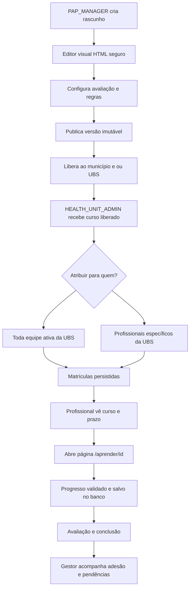

# Perfis, jornadas, navegação e regras de distribuição

**Segurança: papel NÃO é privilégio em si.** O backend deve conferir `getEffectiveAccessProfile`, escopo ativo, MFA e grants reais. A UX mostra ações condicionais, mas APIs fazem autorização independente.

## Matriz de capacidades esperadas (permissões deverão ser provisionadas e testadas)

| Ação | PAP_ADMIN | PAP_MANAGER | MUNICIPAL_ADMIN | HEALTH_UNIT_ADMIN | PROFESSIONAL | COMMERCIAL |
|---|---|---|---|---|---|---|
| Administração global de rede | sim | criação delegada restrita | próprio município | própria UBS (somente escopo) | não | não |
| Criar município | sim | sim, se grant explícito | não por padrão | não | não | não |
| Solicitar/cadastrar UBS/hospital | sim | sim, como pendente | conforme grant e município | não ativa | não | não |
| Ativar UBS | **exclusivo Admin global** | NÃO | NÃO | NÃO | NÃO | NÃO |
| Remover UBS | política original Admin | NÃO | NÃO | NÃO | NÃO | NÃO |
| Convidar Comercial | sim | sim com grant de convite específico | não | não | não | não |
| Abrir Vitrine | somente com grant comercial adicional | somente com grant comercial adicional | somente com grant comercial | somente com grant comercial | somente com grant comercial | sim |
| Criar/editar conteúdo curso | se grant editor | **sim** | não | NÃO | não | não |
| Publicar/liberar curso institucional | se grant editor | **sim** | distribuição municipal autorizada, se prevista | NÃO publica catálogo | não | não |
| Distribuir curso a profissionais de UBS | não implícito | não atua como gerente da equipe | não por padrão | **sim, em sua unidade** | não | não |
| Definir deadline por matrícula | sob delegação formal | define defaults de curso/publicação, não atribui diretamente | só com grant | **sim (sua equipe)** | não | não |
| Ver progresso de cursos da equipe | relatório agregado autorizado | somente métricas de distribuição autorizadas, sem PHI | próprio município (mínimo necessário) | própria unidade | somente próprio progresso | demo |
| Ler prontuários clínicos | somente com grant clínico separado | NÃO | somente com grant clínico separado | somente com grant clínico separado | nas UBS autorizadas | NÃO |

As colunas definem **produto desejado**, não afirmam que os grants já existam no banco. Não reaproveitar `organization.read` para liberar curso/escrita; criar permissões específicas e auditáveis (`course.read`, `course.edit`, `course.publish`, `course.distribute`, `course.assign`, `course.progress.own.read`, `course.progress.unit.read`) de acordo com o catálogo IAM existente. Evitar grants globais largos.

## Fluxo de ponta a ponta

### PAP_MANAGER

Shell verde-petróleo claro/escuro (mesma identidade Admin, mas HOME como bancada de ações sem dashboard/contadores): `Municípios`, `Solicitações de unidades`, `Cadastrar Comercial`, `Vitrine (se autorizado)`, `Cursos`, `Biblioteca de materiais`, `Distribuição institucional`, `Configurações`, Ajuda. Entrada `PAP_MANAGER` deve vir do resolvedor real, nunca forçar `/admin` global. Sem 8 KPIs e sem acesso à leitura de pacientes. CRUD de município/unidade respeita processo original e auditoria. O MANAGER edita/versões/retira cursos; nunca altera progresso de alunos.

### HEALTH_UNIT_ADMIN

Entra no MESMO `DashboardShell` clínico quando possui acesso clínico, com as mesmas rotas e sidebar do `PROFESSIONAL`; se NÃO possui grants clínicos, disponibilizar `Cursos` e gestão de equipe num workspace equivalente sem conceder leitura/atendimento. Nunca contornar MFA/guard para atender a proposta de UX. Aba `/cursos`: `Meus cursos`, `Liberados para unidade`, `Enviados à equipe`, `Pendências`, `Concluídos`. Um curso disponível na unidade não é automaticamente matrícula para todos.

No drawer `Atribuir curso`: dados do curso em READ-ONLY, seleção `toda equipe ativa` ou `selecionados`, busca nomes/roles, contagem real de selecionados, obrigatoriedade, prazo com fuso/horário bem definido, mensagem opcional e prévia. Salvar como rascunho de distribuição (opcional) ou enviar atomicamente. Usuários já atribuídos: não duplicar, mostrar `já atribuído`. Não atribuir a usuários de outra UBS, inativos, desprovidos de vínculo, ou a própria conta como efeito lateral não autorizado.

### PROFESSIONAL

`Meus cursos` com busca, status, prazo/atraso, conclusão e certificados apenas verdadeiros. Card `Iniciar/Continuar/Revisar/Refazer` conforme registro persistente. Player mostra módulos e aulas autorizadas, progressos, tarefas, botão retomar; nenhuma edição/publicação. Falha de rede: feedback claro e estado de salvamento confirmado pela API.

### MUNICIPAL_ADMIN

Pode acompanhar cursos que a PAP liberou ao município, ver suas UBS elegíveis e distribuição agregada mínima. Curso não chega automaticamente ao profissional sem atribuição do gestor da UBS. Se for permitido encaminhar release a unidades, apenas sob grant explícito e município ativo, com trilha de auditoria.

### PAP_ADMIN

Sidebar Admin Premium teal light/dark; hierarquia `Rede de Saúde → Municípios → UBS/Hospitais → Membros e Responsáveis`, sem dados clínicos nessa área. Manter todas as seções anteriores, incl. pessoas/acessos, solicitações, convites, segurança, métricas, monitoramento e integrações. Usar APIs existentes; novos vínculos/chefias dependem de grants e fluxos já definidos; não inventar 12 profissionais/3 hospitais como números reais a partir do mockup.

## Rotas sugeridas (adaptar ao App Router existente)

- Admin: `/admin/rede`, `/admin/rede/[organizationId]` (já há rota dinâmica, reutilizar), subabas internas `unidades`, `integrantes`, `responsaveis`, `historico` se há APIs; não criar páginas com dados clínicos fake.
- MANAGER: preferir namespace `/admin/manager/...` ou rotas já usadas, com guard PAP_MANAGER e sem colisão com o Admin Global; confirmar `accessDestination` no código antes de fixar URLs.
- Cursos operacional: `/cursos`, `/cursos/[id]`, `/cursos/equipe` (privado do unit admin), `/aprender/[enrollmentId]`.
- Demo: `/vitrine/cursos`, `/vitrine/aprender/[demoEnrollmentId]` (estado sintético, sem API privada).
- API: `/api/courses/...` ou convenção existente do projeto, todas com MFA/grants/tenant checados.

**A decisão de URLs pode ser alterada na implementação se mantiver os contratos acima; não duplicar login nem banco.**
